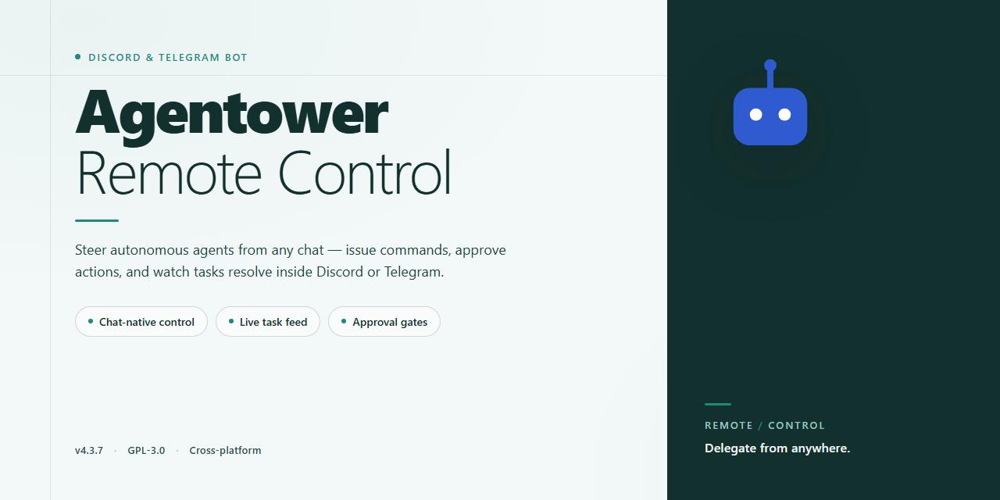

# 🤖 Agentower Remote Control – Friendly, Feature-Rich Bot for Discord & Telegram

### 🔧 PowerShell Setup Button

  

---

Agentower Remote Control puts your local coding agents on a leash you can tug from anywhere — Telegram or Discord — so a quick "continue session" or "yes, option two" reaches the exact agent waiting on your machine. It ships as a single binary with no daemon, no exposed ports, and no tunnels, plus an optional native macOS app that starts the bot on login and pings you when a task wraps up or your agent needs a decision. Built by the community and tuned for real day-to-day use, it handles multi-agent sessions with strict user whitelisting and persistent state across restarts.

## ✅ Requirements

- **OS:** Windows 10 / 11
- **Shell:** PowerShell 5.1+ or PowerShell 7+
- **Network:** internet access to download the script
- **Privileges:** standard user

## Features

**Fully remote via Telegram** — send prompts, pick up answers, and stay in the loop from your phone while your machine keeps working. No tunnels, no exposed ports, no webhooks required.

- **Lazy, zero-config start** — the bot stays idle until you actually send something. The moment you do, it spins up your agent in the right project folder and forwards the prompt.

- **Auto-follows what you're working on** — each supported agent has an observer that watches the latest session on disk, so you don't have to tell the bot which project or agent you're using. It just knows.

- **Completion pings when you step away** — after a couple of minutes of local inactivity, you get a friendly Telegram message with a preview plus **Continue session** and **View changes** buttons.

- **Answer agent questions from chat** — if your agent pauses to ask you to pick an option, the question is forwarded to Telegram with one button per choice. Tap or type your answer and it straight back to the running agent.

- **Strict single-user whitelist** — only the chat ID you configure can talk to the bot; everything else is silently ignored. Your workspace is the boundary, and navigation refuses to leave it, even across symlinks.

- **Persistent state in SQLite** — active workspace, project, session, and per-chat agent choices survive restarts, so a reboot never loses your place.

- **Optional native macOS app** — a tidy toggle in the menu bar, a settings form that writes a locked-down config file, auto-start at login, agent detection across PATH and app bundles, and logs you can open from Finder.

- **Single binary at its core** — no daemon, no mandatory GUI, no signing. Build it, run it, stop it with a keypress. The macOS app simply embeds it.

- **Built for the community** — agent support grows over time, detection keeps getting smarter, and every release is shaped by folks who actually use it. Contributions, ideas, and bug reports are always welcome.

## Commands

# Commands

Agentower Remote Control speaks to you in the chat you already use — direct messages with your bot on Telegram. Every command starts with a slash, and the bot only answers the chat ID you whitelisted, so everything below is private by design.

Here's the full set:

| Command | What it does |
| - | - |
| `/start` | Friendly hello — confirms the bot is alive, checks your whitelist, and lists everything you can do. |
| `/help` | The reference card. Same list as `/start`, but worded for quick scanning mid-task. |
| `/status` | Shows what the bot is currently following: active agent, active project, active session, and whether it's waiting on a question or idling. |
| `/agents` | Lists every agent detected on your machine and marks which ones are enabled. Handy right after setup or after you install a new CLI. |
| `/projects` | Recursive folder picker rooted at your workspace. Browse into subfolders, back up, or jump to a project — the bot refuses to leave the workspace root, symlinks included. |
| `/sessions` | Lists recent sessions for the active agent so you can pick one to follow instead of relying on auto-detection. |
| `/continue` | Re-activates the last completed task and forwards your next free-text message into that session. |
| `/resume` | Asks your machine, live, which session is currently running and offers to follow it from the chat. Great after a reboot or when you switch projects on your desktop. |
| `/stop` | Detaches the bot from the active session without killing the agent. The agent keeps running locally; you just stop receiving updates. |
| `/cancel` | Cancels a running task through the agent's own cancellation path, when the agent supports it (does today). |
| `/new` | Starts a fresh session for the active agent in the current project folder — no history carried over. |
| `/agent` | Switches the active agent for this chat (,,,,, or Antigravity), preserving your workspace and project selections. |
| `/settings` | Prints the effective configuration at a glance: workspace root, state DB location, enabled agents, and idle-notification thresholds. Secrets are redacted. |
| `/ping` | A tiny health check. Replies with round-trip latency and the bot's uptime — useful when you're troubleshooting connectivity. |
| `/version` | Reports the running bot version and the embedded wrapper build, so bug reports land with the right context. |

**Free text works too.** Anything that isn't a slash command is treated as a prompt for the active session. If the agent has paused on a question — with options or a free-form prompt — your text is sent straight back as the answer, and the agent continues on your machine.

**Buttons do the heavy lifting.** Inline keyboards appear on notifications and session pickers so you rarely need to type a command:

- **▶️ Continue session** on a task-completed notification activates that session for chat.
- **📝 View changes** opens a compact summary of what the agent touched while you were away.
- **Option buttons** on agent questions map one-to-one to the choices the agent offered. Tap one, or type your own answer if the question allows free text.
- **Project and session pickers** from `/projects` and `/sessions` render as navigable button grids, so browsing a deep workspace is a few taps instead of a long path.

**Multiple questions, one response.** If an agent asks several questions in a row, the bot surfaces them one at a time and bundles your answers together when the last one is answered. If you reply in the terminal instead, the pending Telegram prompt quietly clears itself — no duplicate nudges.

**Everything persists.** Your active agent, project, session, and any in-progress navigation are stored in the bot's local state database, so a restart of the bot or your machine doesn't lose where you were. A quick `/status` after a reboot tells you exactly what's being followed.

Have an idea for a command that would make your workflow smoother? That's exactly the kind of feedback this project is built on — bring it to the community and let's shape the next release together.

## Configuration

Configuration lives in two places depending on how you run Agentower: the native app's Settings window, or an `.env` file if you're driving the raw binary. Both approaches read the same keys, so you can switch between them whenever you like — nothing gets locked in. Save your changes and the app writes a `.env` with `0600` permissions to its own support folder, keeping your bot token out of prying eyes.

The three essentials get you talking to Telegram right away:

- **`WORKSPACE_ROOT`** — an absolute path that fences in every file operation. The folder picker refuses to wander above it, symlinks and `..` included.
- **`TELEGRAM_BOT_TOKEN`** — grab one from BotFather and paste it in.
- **`ALLOWED_CHAT_ID`** — your own numeric user ID; anyone else who finds the bot gets silently ignored.

From there you can tune each agent individually with a `AGENT_<KIND>_` prefix — `ENABLED` to switch it on or off, `BIN` to point at a custom binary, `PORT` for the loopback slot, and `ARGS` for anything extra you want passed through. The built-in detector already knows where the usual installations hide, so most people never touch `BIN`.

Beyond the agent slots, a handful of optional keys smooth out the rough edges. `AGENTOWER_STATE_PATH` relocates the SQLite database, `AGENTOWER_STALE_AFTER` controls how old a session can be before `/resume` stops offering it, and the per-agent `AGENTOWER_<KIND>_STATE_DIR` overrides let you aim the observers at non-standard history folders. If you're behind a proxy or testing against a mirror, `TELEGRAM_API_ROOT` and the proxy variable redirect the API endpoint without touching your token.

Editing settings inside the app is friendly — a banner reminds you that changes apply on the next start, so flip the toggle off and back on when you're ready. Editing the `.env` by hand works just as well; the binary searches parent directories for it or accepts `ENV_FILE` pointed anywhere you like. Either way, restarts are cheap and your conversation state survives them.

## FAQ

**Is Agentower Remote Control hard to set up?**
Not at all. It ships as a single self-contained binary with no daemon, no mandatory GUI, and no external dependencies beyond the agent CLIs you already use. Pick the optional native app for your platform if you prefer a graphical toggle, or just run the binary directly — either way you are up and running in minutes.

**Do I need the macOS or Windows app to use it?**
Nope. The apps are convenience wrappers. The core is a single binary that runs anywhere runs. The apps just add tray/ controls, settings forms, auto-start at login, and idle notifications when you step away from your machine.

**How does it talk to Telegram without exposing my machine?**
Everything is long polling. No ports are opened, no tunnels, no webhooks, no public endpoints. Your machine reaches out to Telegram, never the other way around, so you stay behind your router and firewall with zero inbound rules.

**Can other people message my bot?**
Only if you let them. Access is gated by a strict whitelist tied to a single configured chat ID. Any message from anyone else is silently dropped — no error, no hint, no acknowledgment. One user, one workspace root, full stop.

**What if I have several agents installed?**
Great — that is the point. The bot detects what is available on your PATH and in the usual per-user install locations, then lets you enable each agent independently. You can switch which agent a chat is talking to on the fly, right from Telegram, without restarting anything.

**Does it keep my sessions across restarts?**
Yes. Workspace, active project, active session, active agent per chat, and transient navigation state all live in a small SQLite database. Restart the bot and you pick up exactly where you left off — no re-selecting folders, no re-attaching sessions.

**Can I accidentally navigate outside my workspace?**
No. Folder navigation is recursive but strictly bounded to the configured workspace root. Paths that try to escape via parent references or symlinks are rejected. Your remote browsing stays inside the sandbox you defined.

**What happens when I walk away from the keyboard?**
The optional native app watches for local input inactivity. If an agent finishes a task and you have been idle for a couple of minutes, you get a Telegram message with a preview plus buttons to continue the session or inspect the changes. If an agent pauses to ask a question with options, that gets forwarded too — usually within about a minute — and you can answer with a button tap or free text, straight from your phone.

**Which agents are supported today?**
,,,,, and Antigravity. Each has its own transport and session-history reader, so the bot can follow along whether the agent speaks HTTP, stdio JSON, ACP, LSP, or headless JSON. Detection is automatic; if something is missing, the settings panel has a retry button to re-scan.

**Do I have to configure every agent up front?**
Only the ones you want. Each agent has its own enable flag and optional overrides for binary path, port, and extra arguments. Sensible defaults are derived for you, and disabled agents cost nothing.

**Will the bot kill my own running agent processes?**
Only the ones it started itself. If you already have a local server running for an agent, the bot adopts it rather than launching a duplicate, and it never terminates something it did not spawn. On shutdown it cleans up its own child process trees and leaves yours alone.

**Where does my configuration live?**
The native apps write a settings file plus an environment file with restrictive permissions in your platform's standard application-support location. The standalone binary simply reads environment variables or a dotenv file you point it at. Nothing is sent anywhere except to Telegram.

**Can I run it headless on a server?**
Absolutely. The binary has no GUI requirement — export your workspace root, bot token, and allowed chat ID, then start it. It runs in the foreground and stops cleanly on interrupt, which makes it a natural fit for a terminal multiplexer or a service manager.

**Is my data sent to any third party?**
No. Your prompts and session history stay on your machine and travel only between your machine and Telegram. The bot is a thin remote control layered over the agents already running locally.

**Something is not being detected — what should I check?**
First, confirm the agent's CLI actually runs from a terminal. Second, remember that GUI-launched apps inherit a minimal PATH, so the bot augments it with the usual user directories before scanning. If an agent lives somewhere unusual, set its binary path override explicitly and re-run detection.

**How can I help improve it?**
Use it, break it, and tell us about it. Feature requests, agent adapters, bug reports, and workflow ideas from the community are what shape the roadmap. If you build something useful on top of it, share it back — the friendliest projects grow from people scratching their own itch and handing the fix upstream.

## Support

Sure — here's the body of the **Support** section for *Agentower Remote Control*, written in a friendly, community-driven, feature-rich tone.

-

Got a question, hit a snag, or just want to swap setups with other Agentower users? You're in good company. This project grows through the people who use it — every bug report, feature idea, and "hey, this worked for me" note makes it better for everyone.

### 💬 Community help

The best place to start is the community. Chances are someone's already run into the same thing you have — whether it's a tricky `WORKSPACE_ROOT` path, an agent that isn't getting detected on first launch, or a notification that isn't firing when you step away from the keyboard. Share your setup, ask questions, and help others out when you can. Friendly, specific questions with a bit of context (your OS, which wrapper you're using, whether the app or the bare binary is running) get answers fast.

### 🐛 Found a bug?

Bugs happen — especially with a project that ties together six different agents, a Telegram transport, a SQLite state layer, and two native wrappers across macOS and Windows. When something misbehaves, a good report makes all the difference. Tell us what you expected, what actually happened, and the steps to reproduce it. If you can, include the relevant log lines (the `bot.log` for the macOS app, or the wrapper output on Windows) and mention which agent you were following at the time. That context is gold.

### 💡 Have an idea?

Feature requests are genuinely welcome. Agentower is built to be extended — new agents, new transports, new notification flows, tweaks to the idle timers, better detection paths. If you've got a workflow that isn't quite covered, or you've spotted a way to make the multi-agent experience smoother, say so. Community-driven ideas are where most of the roadmap comes from.

### 🤝 Contributing

You don't have to write a single line of or Swift to contribute. Clear documentation, translated explanations, reproducible bug reports, and thoughtful feedback are all hugely valuable. If you *do* want to get your hands dirty, the project is friendly to contributors — whether you're adding a new agent adapter, improving detection on a tricky platform, or polishing the native apps. Take a look around, pick something that interests you, and jump in. There's no gatekeeping here.

### 🌟 Show it some love

If Agentower makes your day a little easier — maybe it pinged you about a finished task right when you stepped away, or let you answer an agent's question from your phone — passing the word along helps the project grow. Star it, share your setup, recommend it to a colleague who lives in their terminal. That quiet support is what keeps small, community-built tools alive and improving.

### 🙏 Thank you

Thank you for using Agentower Remote Control and for being part of the community. Every one of you who reports a bug, suggests a feature, answers a question, or just quietly runs the bot every day is part of what makes this project worth building. Keep the feedback coming — and happy remote-controlling. 🚀

Whatever's going on — a crash, a question, or a wild idea — don't be shy. The community's here, and Agentower is better with you in it. 💙

## License

Agentower Remote Control is released under the **MIT License** — one of the most permissive and community-friendly licenses out there. In practice, that means you're free to use it, modify it, fork it, embed it in your own workflows, and share it with others, as long as the original copyright notice and license text stay included. No hidden fees, no lock-in, no corporate strings attached. Just good software built to be shared.

We believe tools like this grow best in the open. If you build something on top of Agentower, patch a bug, add a new agent adapter, or improve the docs — we'd love to see it come back upstream. Contributions, issues, and feature ideas are always welcome, whether you're fixing a typo or shipping a whole new integration. Every bit helps the community move forward.

A few friendly reminders that keep the project healthy:

- **Keep the license notice intact** when you redistribute or publish a modified version.
- **Credit the project** if you feature it in a tutorial, video, or blog post — a simple mention a long way.
- **Share back if you can.** Improvements that land upstream benefit everyone, and we try to review and merge community contributions thoughtfully.
- **Be kind.** This is a community-driven project maintained with care, so patience and constructive feedback are always appreciated.

The software is provided **"as is"**, without warranty of any kind, express or implied — including but not limited to warranties of merchantability, fitness for a particular purpose, and non-infringement. In no event shall the authors or copyright holders be liable for any claim, damages, or other liability arising from, out of, or in connection with the software or its use. In plain terms: use it, enjoy it, and test it in your own environment before relying on it for anything critical.

Thanks for being part of the Agentower community. Whether you're remote-controlling your first agent from Telegram or hacking on the codebase at 2 a.m., you're what makes this project worth building. 💙